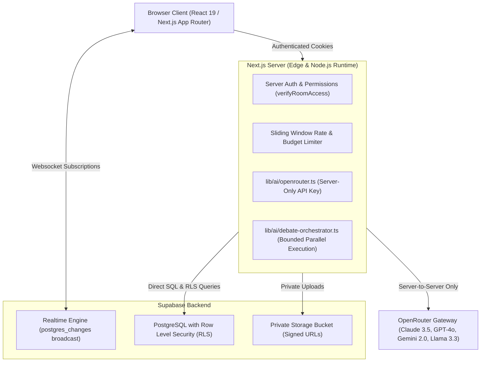

# TeamMind — Collaborative AI Brainstorming Workspace

**TeamMind** is a shared browser-based AI workspace for product and engineering teams. It allows cross-functional members to brainstorm together in real time, consult leading AI models via OpenRouter, challenge ideas through structured multi-model debates with automatic synthesis, and capture discussion insights into an actionable project knowledge repository (ideas, votes, comments, action items, and reference documents).

---

## Architecture & System Design



### Key Security & Boundary Guarantees
1. **Server-Isolated Secrets:** The `OPENROUTER_API_KEY` and `SUPABASE_SERVICE_ROLE_KEY` exist strictly in server-side memory and are never exposed via `NEXT_PUBLIC_` variables or bundled into client code.
2. **Row-Level Security (RLS) & IDOR Protection:** Every table (`workspaces`, `projects`, `rooms`, `messages`, `ai_runs`, `ideas`, `action_items`, `project_files`) has RLS enabled with security definer functions (`is_workspace_member`, `is_workspace_owner`), preventing users from accessing cross-workspace resources by manipulating URLs or IDs.
3. **Model Validation Allowlist:** Arbitrary client-specified model IDs are rejected. Only validated, server-approved models in `lib/ai/model-config.ts` are executed.
4. **Document Privacy:** Files uploaded to project storage are kept strictly private. Project documents are never automatically or silently ingested into AI prompts without explicit opt-in.
5. **Cost & Rate Controls:** Requests are constrained by a sliding-window rate limiter per user and per workspace, alongside configurable monthly budget limits.

---

## Core User Journeys Supported

1. **Workspace & Team Invitations:** Workspace owners can invite collaborators via email with expiring cryptographic tokens.
2. **Shared Discussion Rooms:** Members converse in shared rooms with instantaneous updates via Supabase Realtime.
3. **Single-Model Consultation:** Team members can select from approved models (Claude 3.5 Sonnet, GPT-4o, Gemini 2.0 Flash, Llama 3.3 70B, DeepSeek V3) to analyze questions with conversation history context.
4. **Multi-Model Debates & Synthesis:**
   - **Opportunity Scan:** Identifies high-leverage user needs and overlooked solutions while separating evidence from speculation.
   - **Red-Team Critique:** Stresses ideas to expose critical vulnerabilities, blind spots, failure modes, and unproven assumptions.
   - **Feasibility Review:** Evaluates engineering, operational, and regulatory constraints, highlighting missing information.
   - **Synthesis Engine:** Bounded parallel model execution followed by a synthesis model that extracts points of agreement, meaningful contradictions, and prioritized next steps.
5. **Ideas Repository:** Convert discussion points into persistent ideas with status tracking (`proposed`, `under_review`, `accepted`, `rejected`, `implemented`), tags, comments, and single-vote-per-member mechanics.
6. **Action Items:** Track tasks with assignee profiles, statuses (`open`, `in_progress`, `blocked`, `completed`), and due dates.
7. **Document Reference:** Upload reference documents (PDF, Markdown, TXT, CSV, DOCX) up to 10MB into secure private storage.

---

## Quick Start & Local Setup

### Prerequisites
- Node.js 18+ (tested on Node v25)
- npm / pnpm

### 1. Clone & Install Dependencies
```bash
git clone <repository-url>
cd teammind
npm install
```

### 2. Environment Configuration
Copy `.env.example` to `.env.local`:
```bash
cp .env.example .env.local
```

Fill in your configuration:
```env
NEXT_PUBLIC_SUPABASE_URL=https://your-supabase-project.supabase.co
NEXT_PUBLIC_SUPABASE_ANON_KEY=your-supabase-anon-key
SUPABASE_SERVICE_ROLE_KEY=your-supabase-service-role-key
OPENROUTER_API_KEY=your-openrouter-api-key
OPENROUTER_DEFAULT_MODEL=anthropic/claude-3.5-sonnet
APP_URL=http://localhost:3000
```
*(Note: If `OPENROUTER_API_KEY` is not provided, TeamMind automatically uses intelligent mock AI responses so you can develop and test without spending credits).*

### 3. Database Migrations
Apply the initial migration from `supabase/migrations/00001_initial_schema.sql` to your Supabase PostgreSQL instance using the Supabase CLI:
```bash
supabase db push
# or execute supabase/migrations/00001_initial_schema.sql in the Supabase SQL Editor
```

### 4. Run Development Server
```bash
npm run dev
```
Open [http://localhost:3000](http://localhost:3000) to access the workspace.

---

## Running Tests

TeamMind includes a Vitest test suite verifying authentication boundaries, RLS mocks, IDOR prevention, rate limiting, and multi-model debate resilience:
```bash
npm test
```

### Verified Test Scenarios
- `tests/unit/permissions-and-access.test.ts`:
  - Session verification & 401 unauthenticated enforcement.
  - Workspace membership & owner-only permission checks.
  - Cross-workspace access denial (IDOR security).
  - Room & project isolation.
- `tests/unit/ai-and-debate.test.ts`:
  - Secret isolation (OpenRouter key is never in public or client bundles).
  - Arbitrary model ID rejection.
  - Mock AI fallback mode for safe test execution.
  - Multi-model partial failure handling and synthesis accuracy.
  - Non-smoothing synthesis prompt verification (preserving conflict & uncertainty).
  - Rate limiting & budget ceiling enforcement.
- `tests/unit/validation-schemas.test.ts`:
  - Zod validation for workspace, projects, rooms, and debate bounds.
  - Single-vote-per-user constraint validation.
  - Prompt length and payload character limits.

---

## Known Limitations & Roadmap

1. **RAG & Chunking:** Document uploads are securely stored in private storage. Future phases will introduce pgvector embeddings and hybrid vector search with explicit per-document inclusion checkboxes.
2. **Streaming in Multi-Model Debate:** Individual debate responses currently resolve in parallel and persist upon completion. A future optimization will stream individual column outputs side-by-side.
3. **Workspace Analytics:** Add exportable CSV/JSON reports for team AI usage, top-voted ideas, and sprint velocity.
